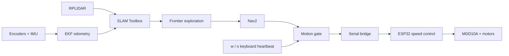

# KASHIF — Autonomous Mapping Rover

An autonomous indoor mapping rover using ROS 2 Jazzy, SLAM Toolbox and Nav2. A Raspberry Pi runs localization, planning and frontier exploration; an ESP32 handles encoder feedback and motor speed control.

**Status:** software compiled and tested in Gazebo; physical calibration and commissioning pending.



### Repository layout

- `firmware/`: ESP32 encoder, IMU and motor controller.
- `rover_ws/src/`: ROS nodes, launch files, configuration and simulation model.
- `tests/`: transport, motion gate, firmware and simulation checks.
- `verification/`: recorded software test results.
- `hardware/stl/`: chassis, wheel, rim, lidar cover and mounting part meshes.
- `BOM.md`: bill of materials placeholder.

Targets Ubuntu 24.04 + ROS 2 Jazzy, Gazebo Harmonic, Raspberry Pi 5, an **original ESP32 Dev Module**, Cytron MDD10A, RPLIDAR A1M8, MPU9250 and two Johnson motors with OE-28 encoders. See `VERIFICATION.md` for the checks actually run and their limits. Physical hardware commissioning is pending.

The rover model is a standard differential drive: the two powered wheel contact points must lie across from each other on the left and right. The proposed front-right/rear-left diagonal layout is not supported by this model. Reposition the wheels before using this configuration, or supply the actual drive geometry for a different model.

## 1. System features

- Fixed invalid Xacro expressions, wheel inertias, support wheels, wheel joint states and ROS/Gazebo clock bridging.
- Activated SLAM through its lifecycle launch; explicitly configured the Nav2 servers used by this rover.
- Connected the navigation controller to `/odometry/filtered` and configured a regulated pure pursuit controller that can rotate to face its path.
- Added a separate motor command gate. `o`, a lost operator heartbeat, stale scans/odometry or a base fault disarm it. A new `o` → `w` sequence is required after a fault.
- Replaced the unsafe indefinitely replayed serial command with command/telemetry timeouts and CRC checks.
- Added encoder speed feedback with PI motor control, bounded PWM and a stall timeout. Gains require tuning on the physical motors.
- Handled encoder rollover, firmware reboot, invalid IMU readings and delayed Nav2 goal acceptance after stopping.
- Frontier goals are selected in known free space connected to the robot, with obstacle clearance and cooldowns for failed goals. Small unobserved pockets are ignored. No-frontier detection is not proof of complete map coverage.

## 2. Wire the original ESP32 Dev Module

| Connection | Pin / destination |
|---|---|
| MDD10A left channel PWM / DIR | GPIO 25 / 27 |
| MDD10A right channel PWM / DIR | GPIO 26 / 14 |
| Left encoder A / B | GPIO 34 / 35 |
| Right encoder A / B | GPIO 32 / 33 |
| MPU9250 SDA / SCL | GPIO 21 / 22; address `0x68` |
| ESP32 USB | Pi USB; 115200 baud |
| RPLIDAR USB | Pi USB; 115200 baud for A1 |
| Logic ground | Common ESP32, driver, encoder and IMU ground |

**OE-28 supply and signal voltage are different concerns.** Supply the encoder according to its datasheet (commonly 5 V), then ensure A/B signals entering the ESP32 are limited to 3.3 V. Use appropriate level conversion if the outputs/pull-ups are at 5 V. Do not connect a 5 V output directly to an ESP32 input. GPIO 34/35 have no internal pull-ups; open-collector encoder outputs need external pull-ups compatible with the chosen conversion circuit. Do not assume the breakout has no onboard pull-up to its supply.

Use a fused motor supply matching your exact motors, a separate suitable 5 V regulator for the Pi 5, active Pi cooling and a physical latching E-stop that interrupts motor power. Add pull-down resistors to the driver's PWM inputs so boot/reset cannot leave them floating. The firmware has no physical E-stop sense input: the E-stop must work independently of both computers. Verify motor stall current against the MDD10A channel rating.

The MPU9250 must be rigidly mounted with X forward, Y left and Z up for the supplied fixed transform. Only accelerometer and gyro readings are used; orientation is explicitly marked unavailable. Calibrate gyro Z bias while stationary. The magnetometer is not used.

## 3. Set the physical values before enabling drive

File: `rover_ws/src/rover_bringup/config/rover_config.yaml`

| Parameter | Shipped value | Required action |
|---|---:|---|
| `wheel_radius` | 0.050 m | Measure actual rolling radius |
| `track_width` | 0.320 m | Measure left-to-right contact spacing |
| `encoder_ticks_per_wheel_rev` | 1680 | Measure quadrature transitions per output wheel turn |
| `hardware_calibrated` | **false** | Set true only after geometry, signs and count scale are checked |
| `port` | `/dev/rover_esp32` | Replace with the ESP32's actual stable USB path |
| lidar `serial_port` | `/dev/rplidar` | Replace with the lidar's actual stable USB path |
| `imu_gyro_z_bias` | 0 rad/s | Measure stationary gyro bias |

The symbolic `/dev/rover_esp32` and `/dev/rplidar` devices are not automatically created. Find the real identifiers with `ls -l /dev/serial/by-id/`, unplugging one device at a time to identify each. Use the full stable paths in YAML. If access is denied, add your Linux user to `dialout` and log out/in.

**1680 is an example, not a verified Johnson/OE-28 specification.** It assumes 7 pulses/channel/motor revolution, four-edge decoding and a 60:1 gearbox. Neither the name “OE-28” nor “300 RPM” establishes the actual output counts. Run `ros2 topic echo /rover/encoder_ticks` with drive locked, mark each wheel and count changes over several full turns; divide by turns. The array is `[left, right]`. The firmware counts all valid quadrature transitions.

Wheel radius and track width are read from this YAML by the URDF launch and serial bridge, so they do not need duplicate edits in firmware. Motor/encoder sign constants and pins are in `firmware/rover_esp32/hardware_config.h`. Set encoder signs so a forward hand-turned wheel increments its count, and motor signs so positive drive moves each wheel forward. Check powered motion with the chassis securely raised. PID gains and the conservative 140/255 PWM limit are in `control.h`; tune them for your battery/load.

The model uses a 40 × 26 cm chassis and a conservative 44 × 38 cm Nav2 footprint. Set the actual chassis/sensor locations in the Xacro and both footprints in `nav2_params.yaml` before floor navigation. Maximum requested drive speed is 0.18 m/s and 0.6 rad/s.

## 4. Install and build on the Pi

Install Ubuntu 24.04 64-bit and configure the official [ROS 2 Jazzy apt repository](https://docs.ros.org/en/jazzy/Installation/Ubuntu-Install-Debs.html). This bundle does not install an operating system. Then, from the extracted folder:

```bash
./setup_pi.sh
source /opt/ros/jazzy/setup.bash
source "$PWD/rover_ws/install/setup.bash"
```

The installer adds dependencies and builds the ROS packages. It pins the tested Slamtec driver commit instead of silently using an arbitrary future revision. It does not overwrite a different existing lidar checkout. Repository setup and package installation require internet access and sudo on your Pi.

In each new terminal, source ROS and the workspace again using the actual path where you extracted the bundle.

## 5. Compile and upload firmware

Install [Arduino CLI](https://arduino.github.io/arduino-cli/), then:

```bash
./flash_esp32.sh --install-core
./flash_esp32.sh --check
```

`--check` compiles for `esp32:esp32:esp32` using Arduino ESP32 **2.0.17**; it never uploads. The pin map and binary target are not suitable for ESP32-S2/S3/C3 boards without changes.

When you are ready, disconnect motor power and explicitly upload to the ESP32 port:

```bash
./flash_esp32.sh --upload /dev/serial/by-id/YOUR_ESP32_DEVICE
```

Use the firmware and ROS bridge from the same release; both use the CRC-framed serial protocol.

## 6. Run Gazebo first

```bash
ros2 launch rover_bringup sim.launch.py
```

This starts the simulated rover, an enclosed room with an interior wall, lidar, wheel odometry, EKF, SLAM, Nav2, frontier explorer and RViz. Use `gui:=false` for headless simulation. Headless GPU lidar requires a working EGL/Ogre2 renderer; do not force software OpenGL on an explicitly selected hardware EGL device.

In a second sourced terminal:

```bash
ros2 run rover_bringup explore_keys
```

- `w`: arm the command gate and start automatic frontier mapping once sensors and Nav2 are ready.
- `o`: disarm immediately and cancel exploration. SLAM keeps the accumulated map.
- `q` / Ctrl+C: disarm and exit the key controller.

Keep the key terminal running. Its heartbeat expires after 0.4 s if it disappears. After stale data or a fault, wait for healthy data and press `o`, then `w`. The real ESP32 also stops after 250 ms without a valid command, and the Pi stops relaying a velocity after 250 ms without a fresh command or telemetry.

To choose goals yourself, launch with `explore:=false`, run the key controller to arm, and set goals in RViz. The controller must still be armed for movement.

## 7. Run the physical rover

First inspect telemetry with drive locked (`hardware_calibrated: false`):

```bash
ros2 launch rover_bringup rover.launch.py
```

For a Pi without a display, add `gui:=false` and run RViz on another ROS 2 computer. Check `/scan`, `/wheel/odom`, `/imu/data_raw`, `/odometry/filtered`, `/joint_states`, `/map` and TF. Hand-turn encoders and measure dimensions before setting the calibration flag. The map frame chain is `map → odom → base_link → laser_link`; SLAM owns the first transform and EKF owns the second.

After measurements and lifted-wheel direction/speed checks, restart the launch with your corrected configuration and run `explore_keys` in another sourced terminal. Start at low speed in a clear bounded area with the physical E-stop reachable. A 2D lidar cannot detect stairs or obstacles entirely outside its scan plane.

Save the occupancy map:

```bash
ros2 run nav2_map_server map_saver_cli -f "$HOME/rover_map"
```

This produces a map image and YAML. The supplied launches perform mapping; saved-map AMCL navigation is not included.

## 8. Re-run software checks

After building the workspace:

```bash
./tests/run_checks.sh
./flash_esp32.sh --check
python3 tests/sim_smoke.py --log-dir /tmp/rover-navigation-test
python3 tests/sim_smoke.py --autonomous --log-dir /tmp/rover-exploration-test
```

The Python/host tests exercise transport corruption, timeouts, stop priority, rollover, reboot, calibration lock, frontier selection and action-cancellation races. The native firmware loop uses fake GPIO/UART/I²C to check actual control-loop stop paths; it does not replace a test on the ESP32. Gazebo tests run in isolated ROS domains and Gazebo partitions and shut down their own launch processes.

## Sources

- [Slamtec ROS 2 driver](https://github.com/Slamtec/sllidar_ros2), pinned to `34300099fadfc772965962dec837bf436706188f`
- [Nav2 mapping with SLAM](https://docs.nav2.org/jazzy/tutorials/general_tutorials/navigation2_with_slam/navigation2_with_slam/)
- [Espressif Arduino installation](https://docs.espressif.com/projects/arduino-esp32/en/latest/installing.html)
- [OE-28 reference sheet](https://robu.in/wp-content/uploads/2019/03/300738-2.pdf) — verify your exact encoder and gearbox
